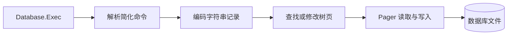

# mydb

**A small database storage experiment in Go.**

[存储层](store/) · [命令层](db/) · [测试示例](test/) · [English overview](#english-overview)

从一行数据如何编码开始，逐步探索它怎样落到磁盘页、进入树结构，再被查找和删除。这是学习数据库内部实现的实验项目，模块名为 `mySQLite`；它不兼容 SQLite 的 SQL 或文件格式。

## 实现范围

| 层次 | 代码中的内容 | 阅读入口 |
| --- | --- | --- |
| 记录 | 字符串字段编码与解码 | [record.go](store/record.go) |
| 磁盘页 | 4096 字节分页、按页读写与分配 | [pager.go](store/pager.go) |
| 树结构 | 叶子页、内部页、分裂、查找和基础删除 | [btree.go](store/btree.go) |
| 表与元数据 | 表定义、根页记录和重开文件后的元数据读取 | [database.go](db/database.go) |
| 命令入口 | 简化的 CREATE、INSERT、SEARCH、DELETE 分派 | [executor.go](db/executor.go) |

## 一条记录经过哪些步骤



## 本地阅读与验证

使用 Go 1.24 或更高版本，版本要求见 [go.mod](go.mod)。

```bash
git clone https://github.com/dailyun/mydb.git
cd mydb
go test ./store
go test ./...
```

测试包含记录编解码、分页读写、多行插入和分裂示例。部分集成测试会在当前测试目录创建数据库文件，建议在独立克隆中运行。

`main.go` 目前调用 `SELECT * FROM users;`，但命令分派尚未实现 SELECT。因此，`go run .` 不是完整的查询演示；先从源码和测试阅读实现。

## 阅读路线

1. [记录编解码](store/record.go)：字段怎样变成字节，又怎样还原。
2. [分页读写](store/pager.go)：页号怎样映射到文件偏移。
3. [页结构](store/btree.go)与[插入](store/btree_insert.go)：记录怎样进入树，满页怎样分裂。
4. [查找](store/btree_search.go)与[删除](store/btree_delete.go)：按第一字段构成的键定位记录。
5. [表与命令](db/table.go)：存储操作怎样连接到简化命令。

## 当前边界

命令解析使用字符串切分，只有很小的语法子集；不能将任意 SQL 交给它。删除实现尚未提供完整的树再平衡，也没有事务、WAL、并发控制和生产级故障恢复保证。请只使用可丢弃的实验数据。

## English overview

mydb is an educational Go database storage experiment. It explores string-record encoding, 4096-byte disk pages, tree insertion and splitting, lookup, basic deletion, and table metadata. The module is named `mySQLite`; it is not a SQLite-compatible database.

Start with `store/record.go`, `store/pager.go`, and the tree implementation, then read the `db/` command layer and test examples. Go 1.24+ is required. The current executable calls an unsupported SELECT command, so the tests and source are the intended starting points. Transactions, WAL, concurrency control, and complete deletion rebalancing are outside the current implementation.
